# Tutorial del Sistema de Asistencia Institucional

Este tutorial explica, paso a paso y con imágenes reales de la aplicación, cómo usar el
sistema para tomar asistencia de estudiantes y controlar la asistencia del personal docente.

Las imágenes fueron tomadas del frontend funcionando con los datos de demostración, por eso
los nombres de alumnos, docentes y cursos son ficticios.

---

## Índice

1. [Qué es el sistema](#1-qué-es-el-sistema)
2. [Cómo abrir la aplicación](#2-cómo-abrir-la-aplicación)
3. [Iniciar sesión](#3-iniciar-sesión)
4. [Conocer la pantalla principal](#4-conocer-la-pantalla-principal)
5. [El panel de inicio](#5-el-panel-de-inicio)
6. [Mi perfil](#6-mi-perfil)
7. [Operación diaria](#7-operación-diaria)
8. [Asistencia docente](#8-asistencia-docente)
9. [Gestión académica](#9-gestión-académica)
10. [Reportes](#10-reportes)
11. [Configuración institucional](#11-configuración-institucional)
12. [Qué puede hacer cada rol](#12-qué-puede-hacer-cada-rol)
13. [Preguntas frecuentes](#13-preguntas-frecuentes)

---

## 1. Qué es el sistema

El Sistema de Asistencia Institucional sirve para:

- Registrar la asistencia diaria de los estudiantes.
- Consultar el historial y calcular la regularidad de cada alumno.
- Avisar automáticamente cuando un estudiante falta varias veces seguidas o está en riesgo
  de perder la regularidad.
- Registrar el ingreso y el egreso de los docentes.
- Controlar tardanzas, salidas anticipadas, ausencias y licencias del personal.
- Descargar reportes en PDF y Excel.

La aplicación se usa desde el navegador. No hay que instalar nada en la computadora del
usuario: sólo se abre una dirección web.

---

## 2. Cómo abrir la aplicación

En la computadora donde está instalado el sistema, abrir una terminal dentro de la carpeta
`proyecto/` y ejecutar:

```powershell
.\scripts\iniciar-aplicacion.ps1
```

Ese comando inicia el servidor y el frontend, y abre el navegador en:

```text
http://localhost:5173
```

Si la aplicación ya está iniciada, simplemente abrir esa dirección en el navegador.

> Si se abre desde otra computadora o celular conectado a la misma red, usar la dirección de
> red local que muestra el script, por ejemplo `http://192.168.0.10:5173`.

---

## 3. Iniciar sesión

Al abrir la aplicación aparece la pantalla de ingreso.

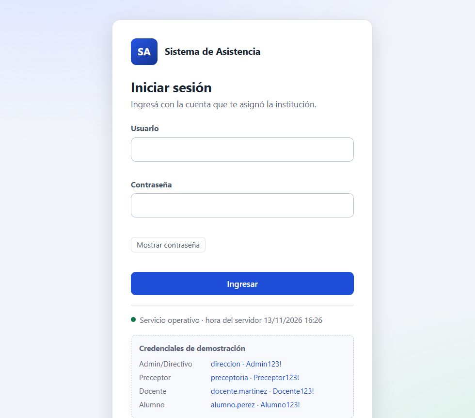

Para entrar:

1. Escribir el **Usuario** asignado por la institución.
2. Escribir la **Contraseña**.
3. Presionar **Ingresar**.

El botón **Mostrar contraseña** permite ver lo que se está escribiendo.

Si el usuario o la contraseña no son correctos, el sistema muestra el mensaje
"Usuario o contraseña incorrectos." por seguridad, sin indicar cuál de los dos datos falló.

### Usuarios de prueba

Con los datos de demostración se puede ingresar con cualquiera de estas cuentas:

| Rol | Usuario | Contraseña |
|---|---|---|
| Admin/Directivo | `direccion` | `Admin123!` |
| Preceptor | `preceptoria` | `Preceptor123!` |
| Docente | `docente.martinez` | `Docente123!` |
| Alumno | `alumno.perez` | `Alumno123!` |

Cada rol ve un menú distinto. Las cuentas de prueba sirven sólo para conocer el sistema; en
un entorno real deben cambiarse.

---

## 4. Conocer la pantalla principal

Después de ingresar, la pantalla tiene tres partes:

- **Barra superior:** muestra el nombre del sistema, el usuario conectado, su rol y el botón
  **Salir**.
- **Menú de navegación:** agrupa las pantallas por tema (Operación diaria, Asistencia
  docente, Gestión académica, Administración). En pantallas chicas se abre con el botón de
  tres líneas (☰).
- **Contenido:** es la parte central, donde se trabaja. Cambia según la opción elegida.

Para moverte por el sistema, hacé clic en una opción del menú. La opción activa queda
resaltada.

---

## 5. El panel de inicio

El **Panel** es la primera pantalla y resume lo más importante del día.

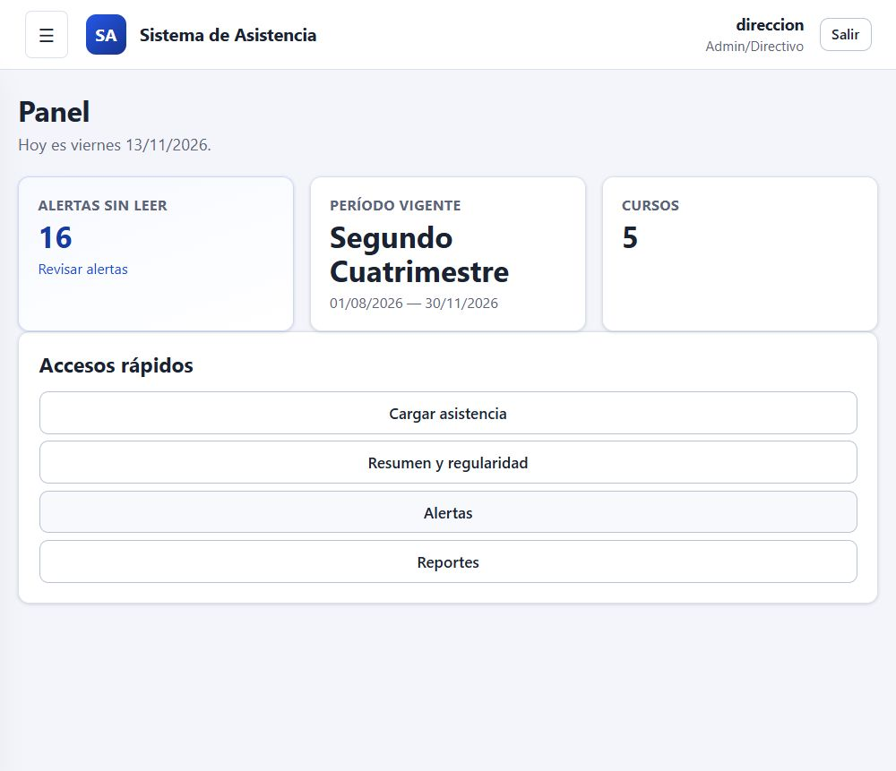

Muestra:

- **Alertas sin leer:** cantidad de avisos pendientes de revisar.
- **Período vigente:** el período académico actual y sus fechas.
- **Cursos:** cantidad de cursos registrados.
- **Accesos rápidos:** botones para ir directo a las tareas más usadas.

El contenido del panel cambia según el rol: un docente ve sus clases y firmas pendientes; un
alumno ve su regularidad y sus últimos registros.

---

## 6. Mi perfil

En **Mi perfil** se ven los datos de la cuenta con la que se ingresó.

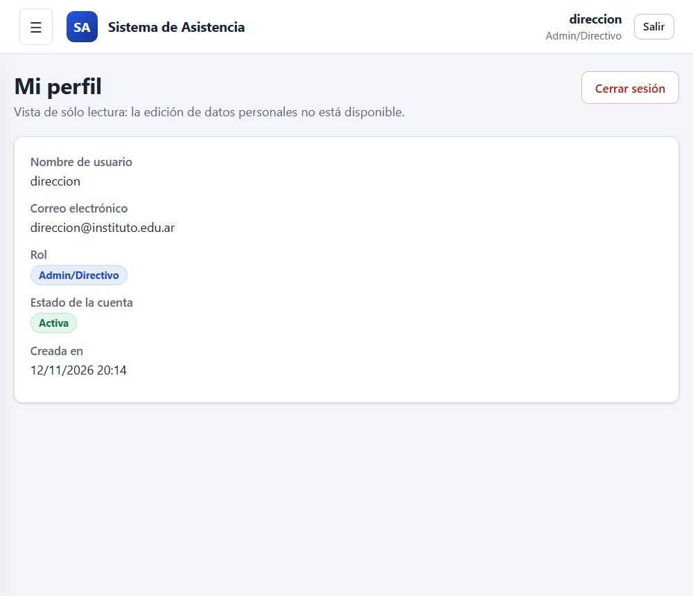

La pantalla es de sólo lectura e incluye:

- Nombre de usuario.
- Correo electrónico.
- Rol.
- Estado de la cuenta.
- Fecha de creación.

Para salir del sistema, usar **Cerrar sesión** o el botón **Salir** de la barra superior. No
existe una opción para cambiar la contraseña desde la aplicación.

---

## 7. Operación diaria

Este grupo reúne las tareas que se hacen todos los días.

### 7.1 Cargar asistencia

Es la pantalla más importante para el uso diario. Permite registrar la asistencia de una
clase completa.

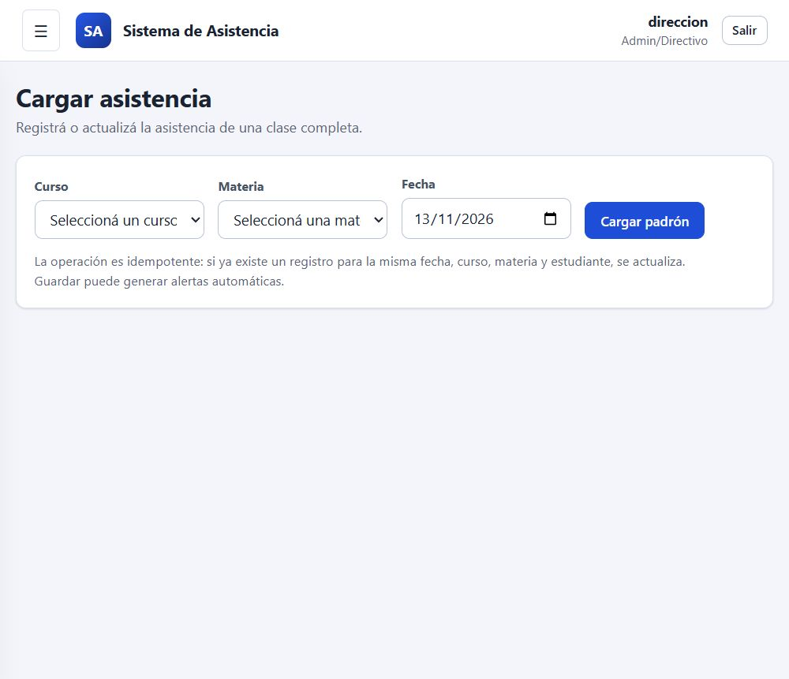

Pasos:

1. Elegir el **Curso**.
2. Elegir la **Materia**.
3. Confirmar la **Fecha** (viene cargada con la fecha de hoy y no puede ser futura).
4. Presionar **Cargar padrón**.

Después aparece la lista de estudiantes del curso. Para cada alumno se elige uno de estos
estados:

- **Presente**
- **Ausente**
- **Justificado**
- **Tarde**

Se pueden usar los botones **Marcar todos presentes** y **Limpiar marcas** para agilizar la
carga. También se puede escribir una observación por estudiante.

Al presionar **Guardar asistencia**, el sistema informa cuántos registros creó y cuántos
actualizó.

> **Importante:** si ya existía asistencia para esa fecha, curso, materia y estudiante, el
> sistema actualiza el registro en lugar de duplicarlo. Además, guardar puede generar alertas
> automáticas por inasistencias.

### 7.2 Consulta de asistencias

Aquí se busca el historial de asistencias ya cargadas.

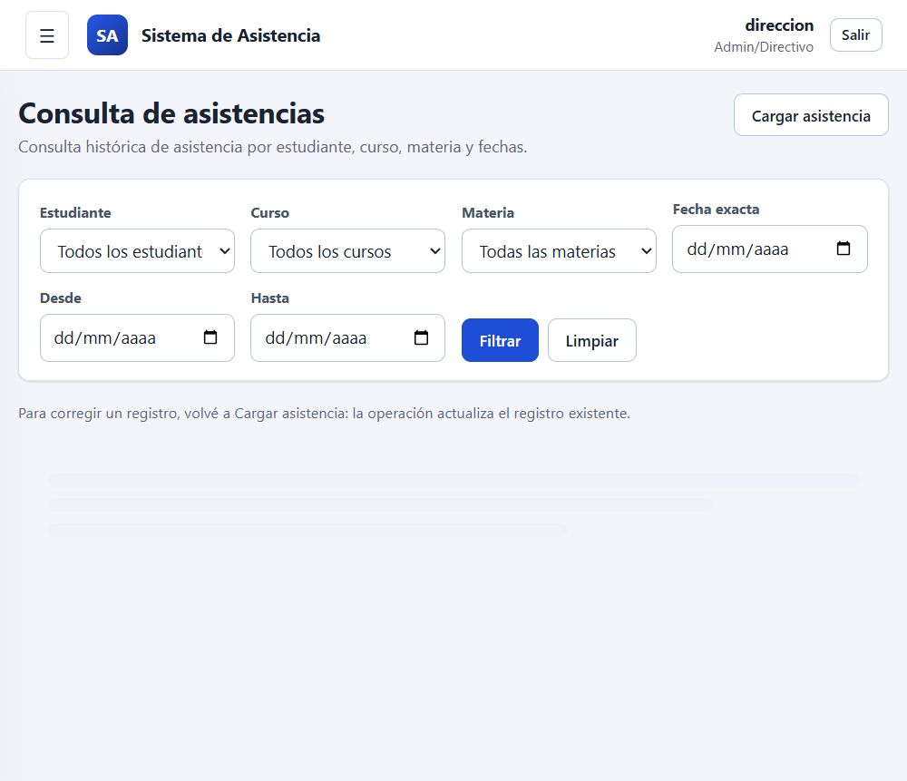

Filtros disponibles:

- **Estudiante**
- **Curso**
- **Materia**
- **Fecha exacta**
- **Desde** y **Hasta** (rango de fechas)

Presionar **Filtrar** para aplicar los filtros y **Limpiar** para borrarlos.

Si un registro está mal cargado, no se edita desde esta pantalla: hay que volver a **Cargar
asistencia** con la misma fecha, curso y materia, y corregir el estado. El sistema actualiza
el registro existente.

### 7.3 Resumen y regularidad

Esta pantalla muestra los porcentajes de asistencia y si el estudiante está regular o en
riesgo.

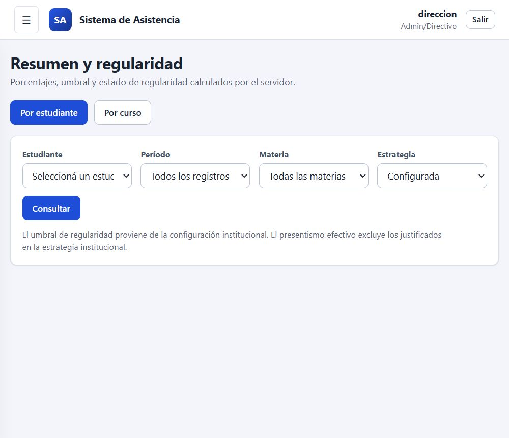

Se puede consultar de dos formas:

- **Por estudiante:** muestra el resumen general del alumno y el detalle por materia.
- **Por curso:** muestra el resumen del curso y la situación de cada estudiante.

Los filtros son **Estudiante** o **Curso**, **Período**, **Materia** y **Estrategia**.
Presionar **Consultar** para ver los resultados.

El sistema muestra tarjetas con:

- Total de registros.
- Presentes, ausentes, justificados y tardes.
- Porcentaje de asistencia.
- Presentismo efectivo.
- Umbral de regularidad.
- Estado: **Regular**, **En riesgo** o **Sin datos**.

El umbral lo define la institución en la pantalla de Configuración. La aplicación no lo
calcula por su cuenta.

### 7.4 Alertas

Las alertas las genera el sistema automáticamente. No se crean ni se editan a mano.

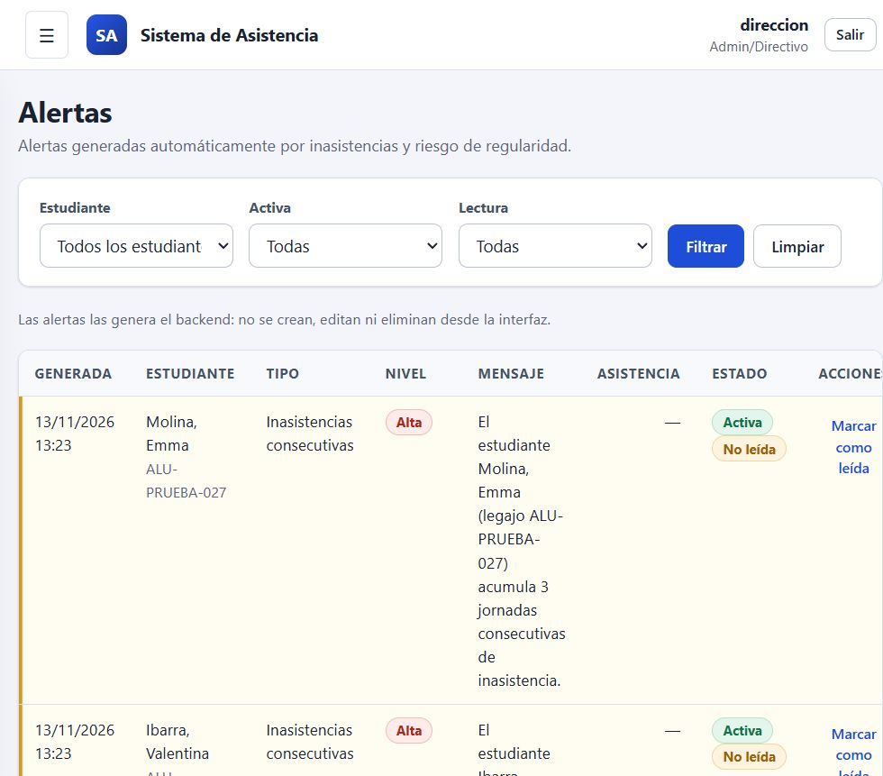

Se pueden filtrar por **Estudiante**, **Activa** y **Lectura**.

Cada alerta muestra:

- Fecha de generación.
- Estudiante.
- Tipo: inasistencias consecutivas o regularidad en riesgo.
- Nivel: alta o media.
- Mensaje explicativo.
- Estado y si fue leída.

Para dar por vista una alerta, usar **Marcar como leída**. La alerta sigue existiendo, pero
deja de figurar como no leída.

---

## 8. Asistencia docente

Este grupo controla el presentismo del personal docente.

### 8.1 Firmas docentes

Permite registrar el ingreso y el egreso de cada docente según su horario.

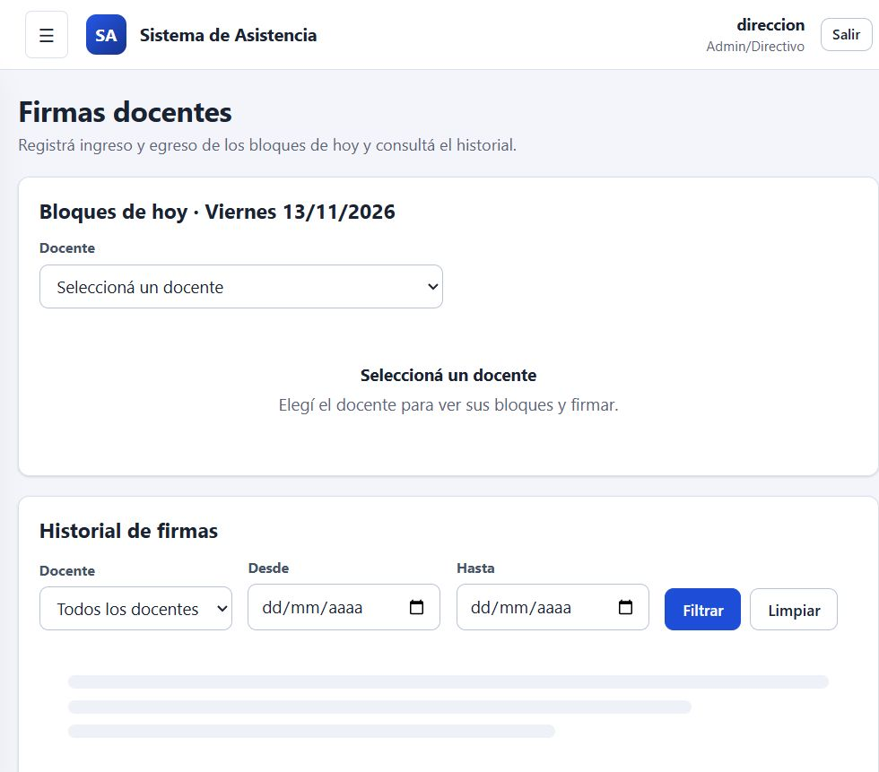

En **Bloques de hoy**:

1. Elegir el **Docente** (el docente conectado ve directamente sus propios bloques).
2. El sistema muestra los bloques de clase de ese día.
3. Presionar **Firmar ingreso** al comenzar la clase.
4. Presionar **Firmar egreso** al terminar.

La hora la registra el servidor; no se puede escribir a mano. Si el ingreso o el egreso se
registran fuera del horario, el sistema puede generar una incidencia por tardanza o salida
anticipada.

En **Historial de firmas** se consultan las firmas ya registradas, filtrando por docente y
por rango de fechas.

### 8.2 Incidencias docentes

Muestra las tardanzas, salidas anticipadas, ausencias y licencias del personal.

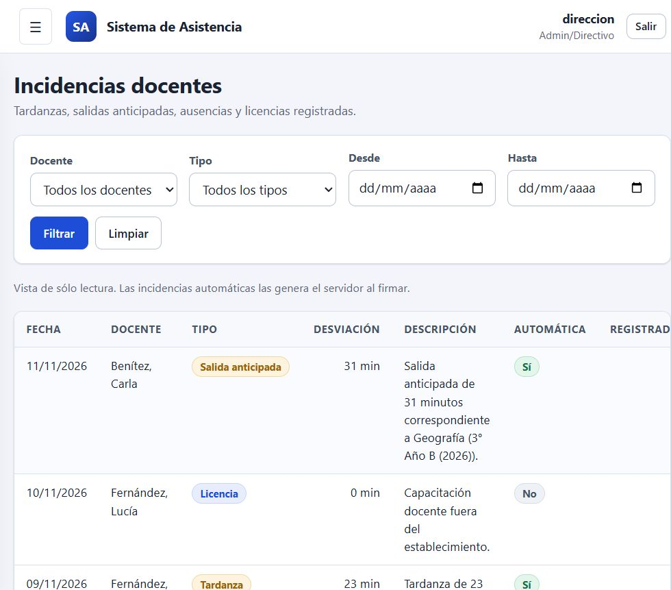

Se puede filtrar por **Docente**, **Tipo**, **Desde** y **Hasta**.

La tabla indica la fecha, el docente, el tipo, los minutos de desviación, la descripción, si
la incidencia fue generada automáticamente y qué bloque horario está asociado.

Esta pantalla es de sólo lectura: las incidencias automáticas las genera el servidor al
firmar, y las licencias se cargan desde su propia pantalla.

### 8.3 Licencias docentes

Permite registrar una licencia para un docente.

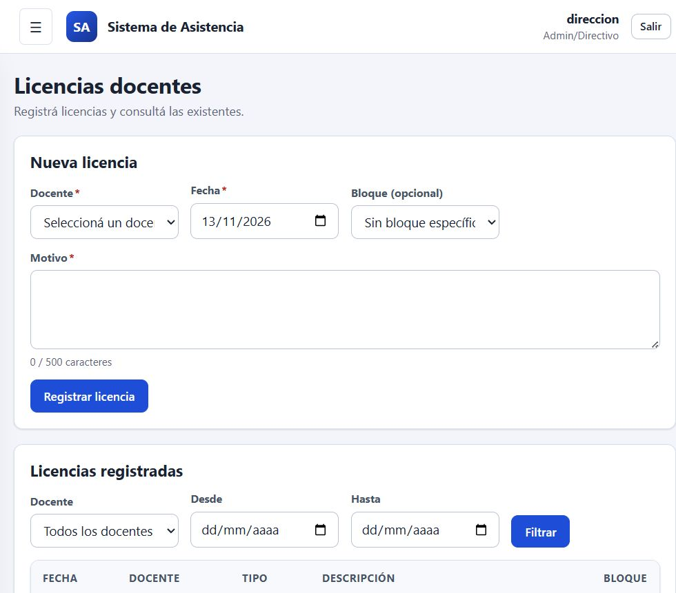

Pasos:

1. Elegir el **Docente**.
2. Indicar la **Fecha**.
3. Opcionalmente, elegir un **Bloque** específico.
4. Escribir el **Motivo** (obligatorio, hasta 500 caracteres).
5. Presionar **Registrar licencia**.

Abajo se listan las licencias ya registradas, con filtros por docente y fechas.

### 8.4 Balance de horas cátedra

Muestra cuántas horas debía trabajar cada docente, cuántas trabajó realmente y cuál es la
diferencia.


Filtros:

- **Período:** si se deja en "Período vigente", el sistema usa el período actual.
- **Docente:** se puede consultar uno o todos.
- **Estrategia:** configuración general, cálculo exacto o por bloques.

Al presionar **Consultar** aparecen tarjetas con clases esperadas, clases completas,
incompletas, sin firma, horas esperadas, horas laboradas, saldo y porcentaje de cumplimiento.

---

## 9. Gestión académica

Este grupo contiene los datos base del sistema: personas, cursos, materias y horarios.

> En general, estas pantallas permiten **consultar** y **crear** registros. No se editan ni
> se eliminan desde la interfaz.

### 9.1 Usuarios

Sólo la ve el rol Admin/Directivo.

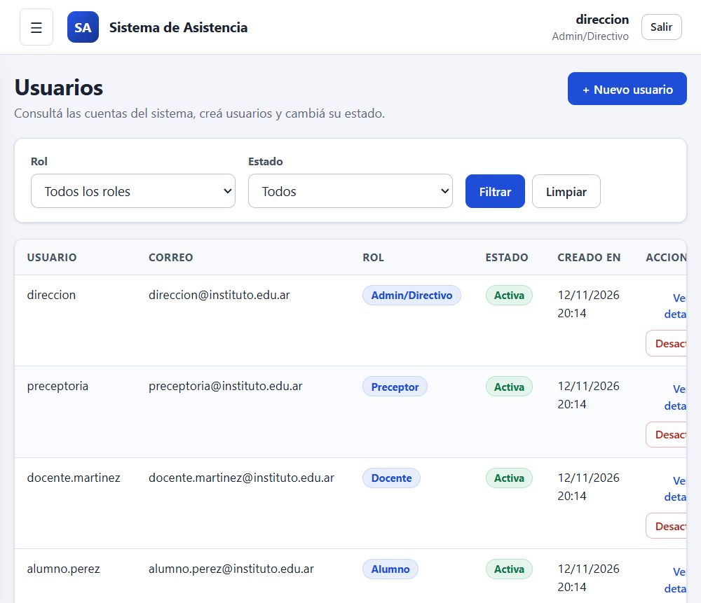

Permite:

- Ver todas las cuentas del sistema.
- Filtrar por **Rol** y **Estado**.
- Crear un usuario con **Nuevo usuario**.
- Ver el detalle de una cuenta.
- **Activar** o **Desactivar** una cuenta.

Para crear un usuario se completan nombre de usuario, correo, contraseña y rol. No se puede
desactivar la propia cuenta.

### 9.2 Estudiantes

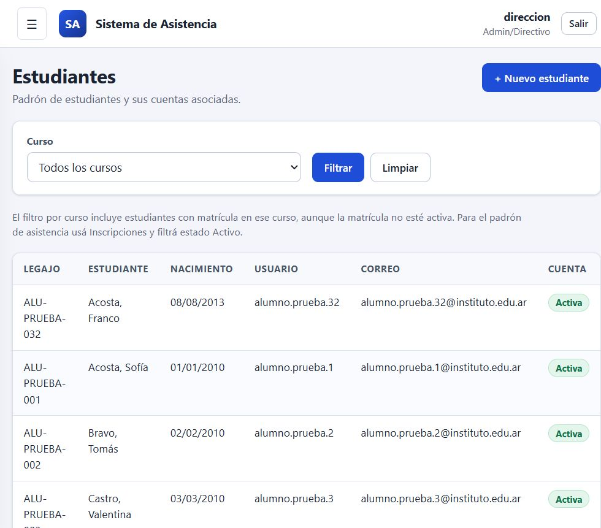

Muestra el padrón de estudiantes con su legajo, nombre, fecha de nacimiento, usuario, correo
y estado de la cuenta.

- Se puede filtrar por **Curso**.
- **Nuevo estudiante** abre un formulario con dos partes: los datos de la cuenta y los datos
  personales del alumno.

### 9.3 Docentes

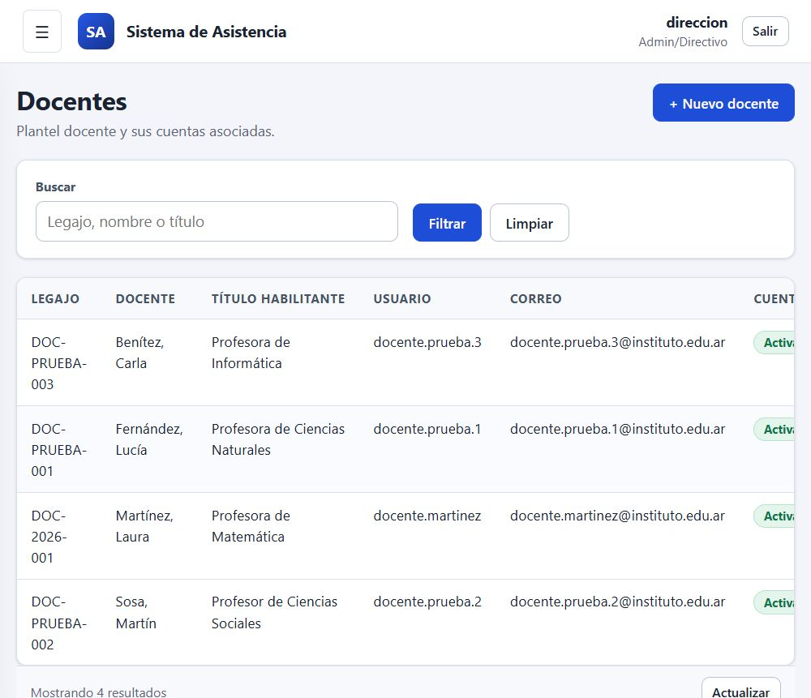

Muestra el plantel docente con legajo, nombre, título habilitante, usuario, correo y estado
de la cuenta.

- Se puede buscar por legajo, nombre o título.
- **Nuevo docente** permite crear la cuenta y los datos del docente en un solo formulario.

### 9.4 Cursos

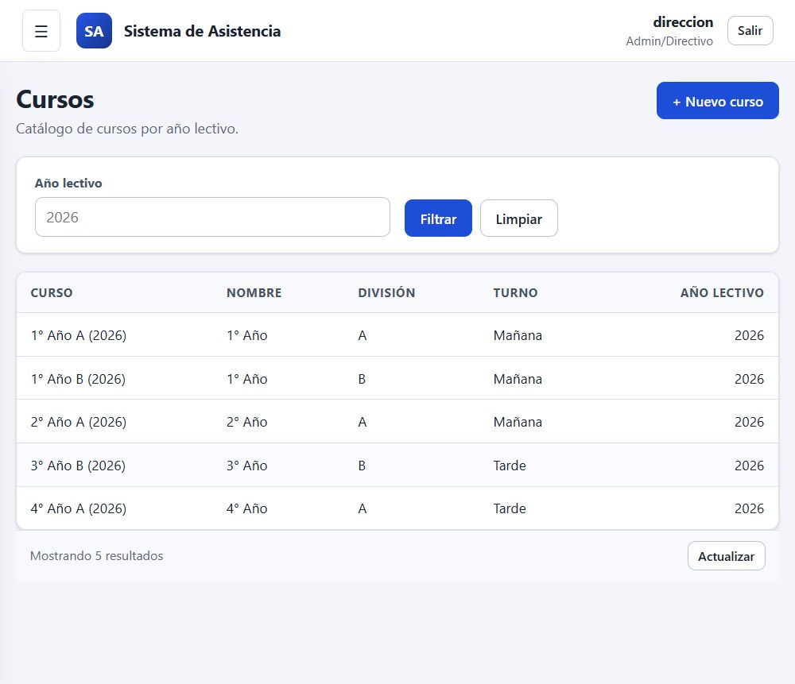

Lista los cursos por año lectivo. Se puede filtrar por **Año lectivo** y crear uno nuevo con
**Nuevo curso**.

Los datos de un curso son: nombre, división, año lectivo y turno (Mañana o Tarde).

Los cursos se usan como opciones en inscripciones, asignaciones, grilla, asistencia, resumen
y reportes.

### 9.5 Materias

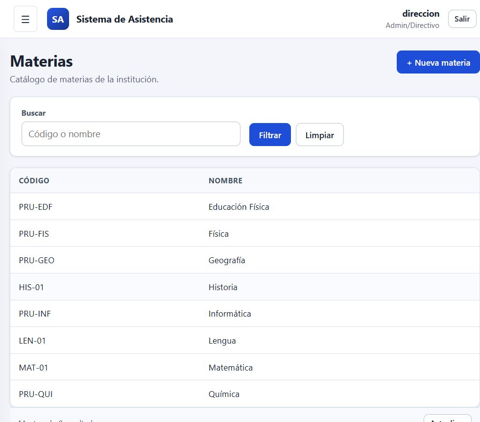

Muestra el catálogo de materias con su código y nombre. Se puede buscar por código o nombre y
crear una nueva con **Nueva materia**.

### 9.6 Períodos académicos

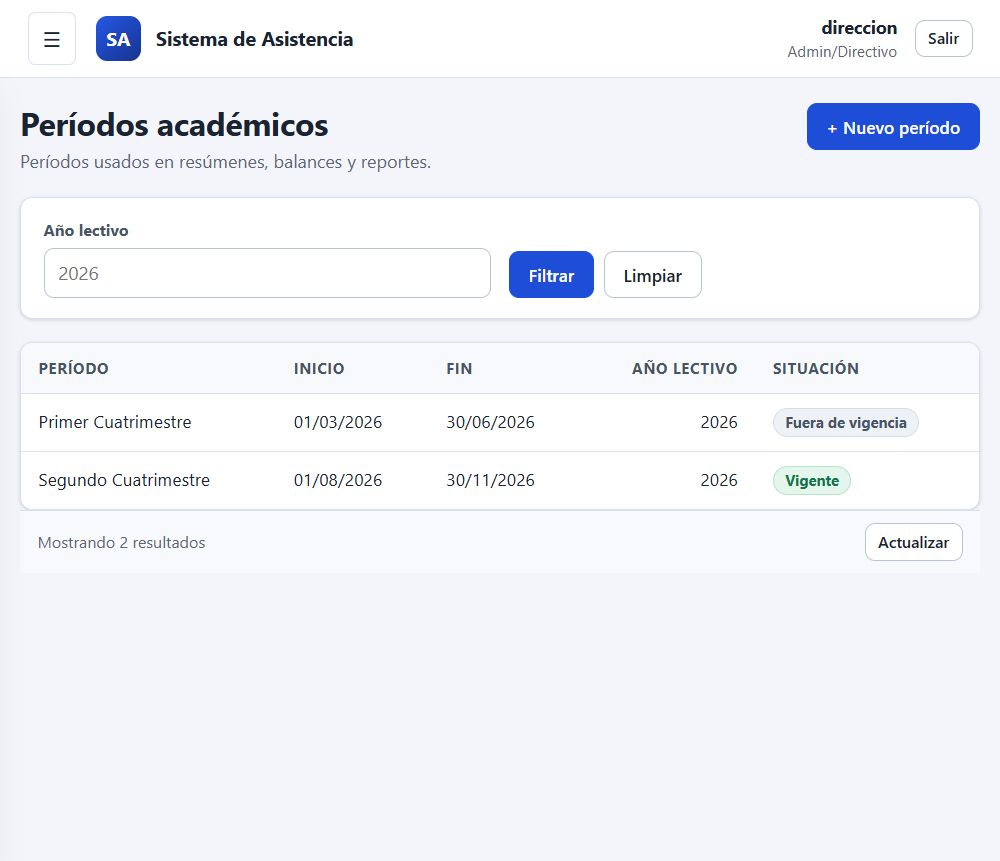

Define los períodos que se usan en resúmenes, balances y reportes (por ejemplo, Primer y
Segundo Cuatrimestre).

La columna **Situación** indica si el período está vigente según la fecha actual. Se puede
filtrar por año lectivo y crear uno nuevo con **Nuevo período**.

### 9.7 Inscripciones

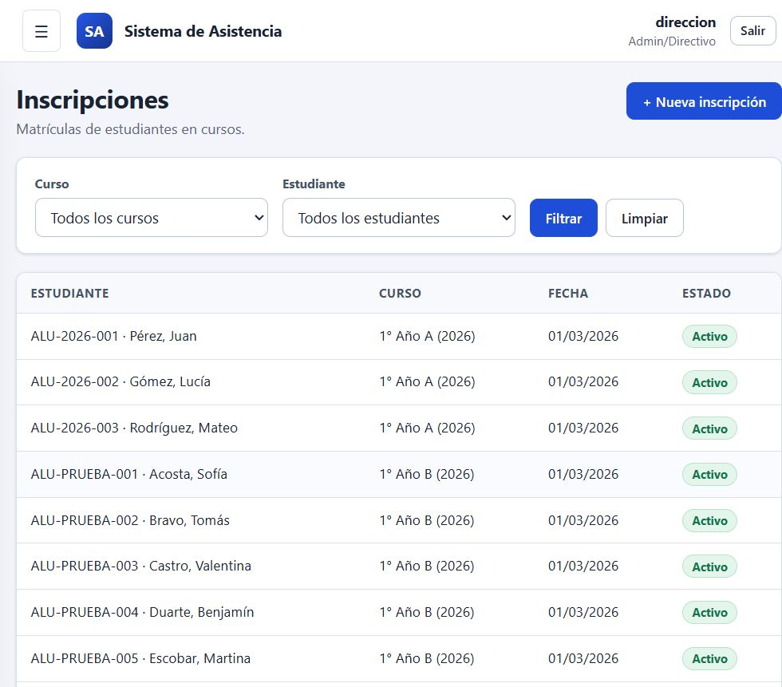

Vincula estudiantes con cursos. Muestra el estudiante, el curso, la fecha de inscripción y el
estado (Activo o Inactivo).

- Se puede filtrar por **Curso** y **Estudiante**.
- **Nueva inscripción** permite matricular un alumno en un curso.

Para tomar asistencia se usan sólo las inscripciones con estado **Activo**.

### 9.8 Asignaciones docentes

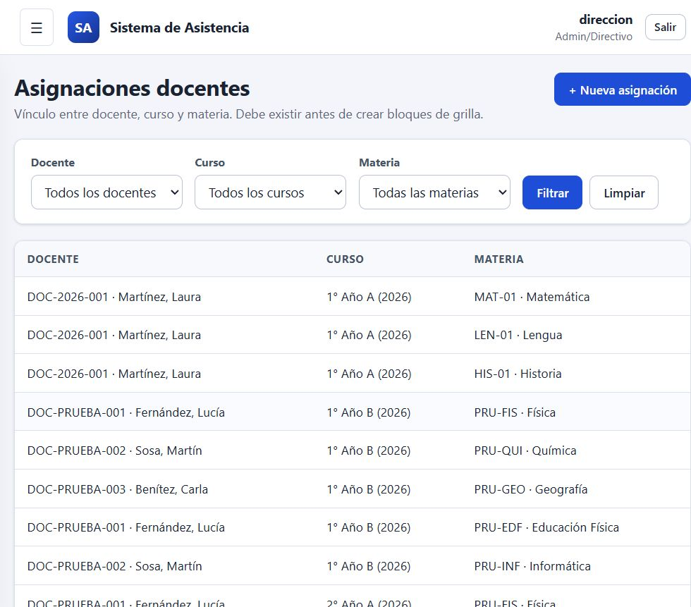

Indica qué docente dicta qué materia en qué curso. Es necesario cargar la asignación antes de
armar la grilla horaria.

Se puede filtrar por **Docente**, **Curso** y **Materia**, y crear una nueva con **Nueva
asignación**.

### 9.9 Grilla horaria

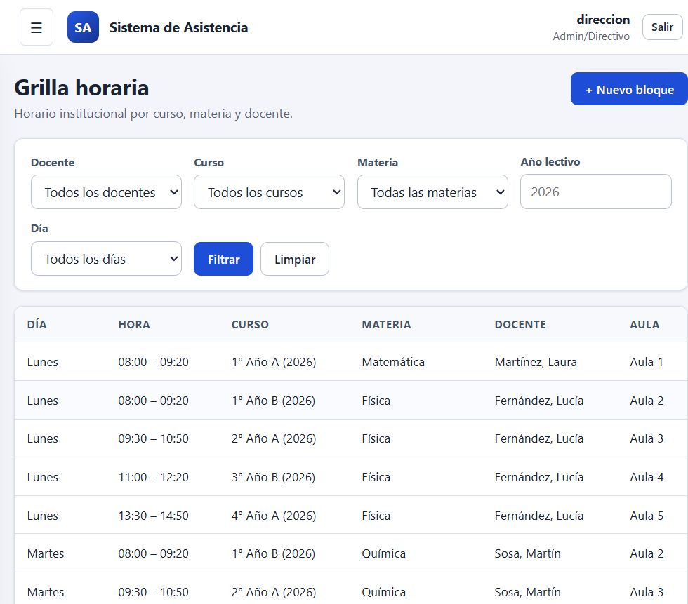

Muestra el horario institucional: día, hora de inicio y fin, curso, materia, docente y aula.

Filtros disponibles: **Docente**, **Curso**, **Materia**, **Año lectivo** y **Día**.

Con **Nuevo bloque** se agrega una clase al horario. Antes debe existir la asignación del
docente para ese curso y materia.

Los docentes y alumnos tienen además una vista **Mi horario** con sólo sus propias clases.

---

## 10. Reportes

La pantalla de Reportes genera archivos formales en PDF y Excel.

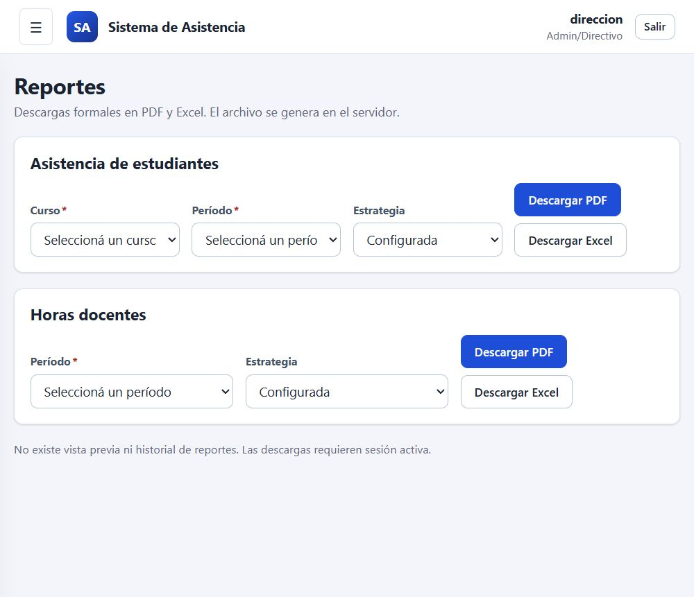

Hay dos reportes:

1. **Asistencia de estudiantes:** se elige **Curso**, **Período** y **Estrategia**. Se puede
   descargar en **PDF** o **Excel**.
2. **Horas docentes:** se elige **Período** y **Estrategia**. Se puede descargar en **PDF** o
   **Excel**.

Al presionar un botón de descarga, el archivo se genera en el servidor y el navegador lo
guarda. Si la generación falla, el error aparece en la misma pantalla.

No hay una vista previa del reporte: se descarga directamente.

---

## 11. Configuración institucional

Esta pantalla sólo la ve el rol Admin/Directivo.

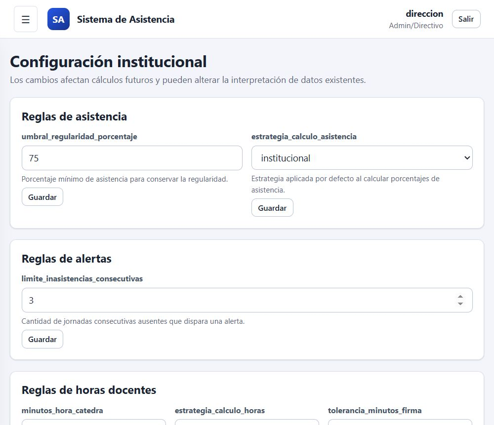

Permite ajustar reglas que afectan los cálculos:

- **Umbral de regularidad:** porcentaje mínimo de asistencia para conservar la regularidad.
- **Estrategia de cálculo de asistencia:** institucional o estricta.
- **Límite de inasistencias consecutivas:** cantidad de faltas seguidas que genera una
  alerta.
- **Reglas de horas docentes:** minutos de hora cátedra, estrategia de cálculo y tolerancia
  de firma.

Cada valor tiene su propio botón **Guardar**. Los cambios afectan los cálculos futuros y
pueden cambiar la interpretación de datos ya existentes; por eso conviene modificarlos con
cuidado.

---

## 12. Qué puede hacer cada rol

El menú se arma según el rol del usuario, así que cada persona ve sólo las opciones que
necesita.

| Rol | Puede hacer |
|---|---|
| **Admin/Directivo** | Todo: usuarios, configuración, reportes, gestión académica, asistencia y control docente. |
| **Preceptor** | Operación diaria, asistencia docente, inscripciones y reportes. No administra usuarios ni configuración. |
| **Docente** | Cargar asistencia de sus materias, consultar, ver alertas, firmar ingreso/egreso y ver su balance y su horario. |
| **Alumno** | Ver su propia asistencia, su regularidad y su horario. No puede cargar ni modificar datos. |

Si un usuario entra por un enlace directo a una pantalla que no le corresponde, el sistema
muestra un aviso de "Sin acceso" y ofrece volver al inicio.

---

## 13. Preguntas frecuentes

**¿Puedo cargar asistencia de un día futuro?**
No. La fecha no puede ser posterior a hoy.

**¿Qué pasa si me equivoco al marcar un estudiante?**
Volvé a Cargar asistencia con la misma fecha, curso y materia, corregí el estado y guardá de
nuevo. El registro se actualiza.

**¿Por qué desaparecen las alertas cuando las marco como leídas?**
No desaparecen: dejan de mostrarse como no leídas. Se pueden volver a ver cambiando el
filtro de lectura.

**¿Puedo editar un curso o un usuario?**
La aplicación permite crear y consultar. Las únicas modificaciones disponibles son activar o
desactivar usuarios, marcar alertas como leídas y cambiar los valores de configuración.

**¿Dónde se guarda la sesión?**
El navegador guarda el acceso mientras la pestaña está abierta. Al cerrar sesión o al vencer
el acceso, hay que ingresar de nuevo.

**¿Necesito internet?**
No. La aplicación funciona en la red local donde están instalados el servidor y el frontend.
